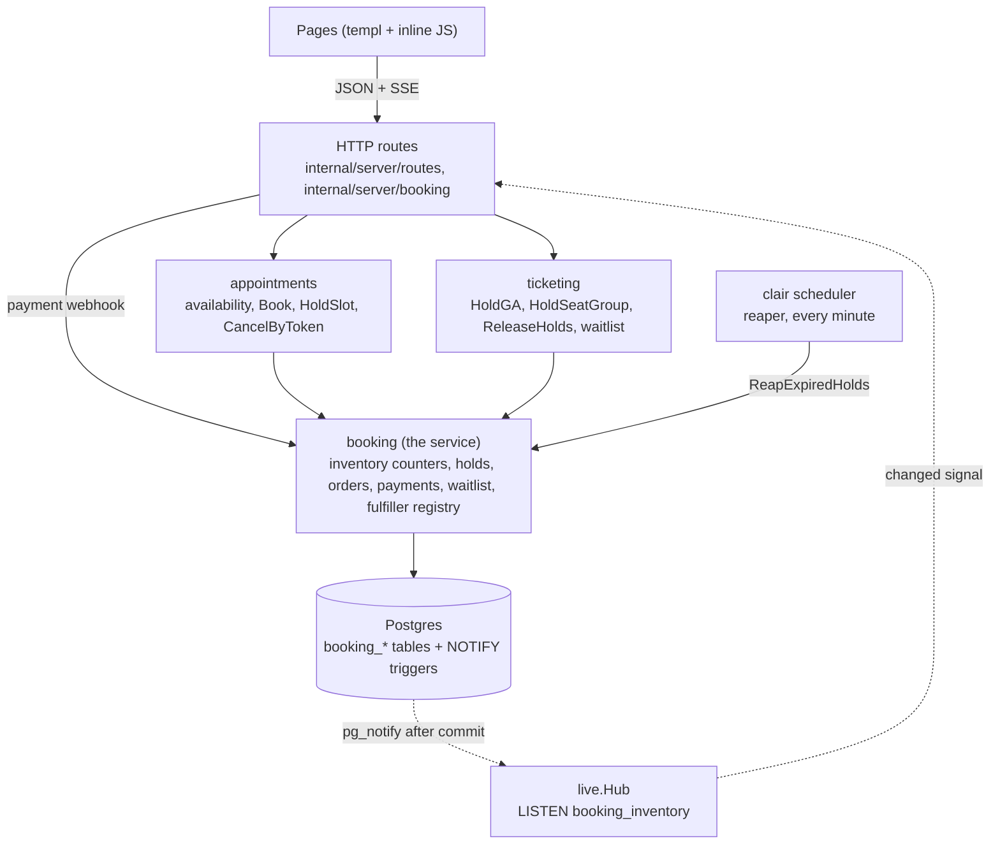
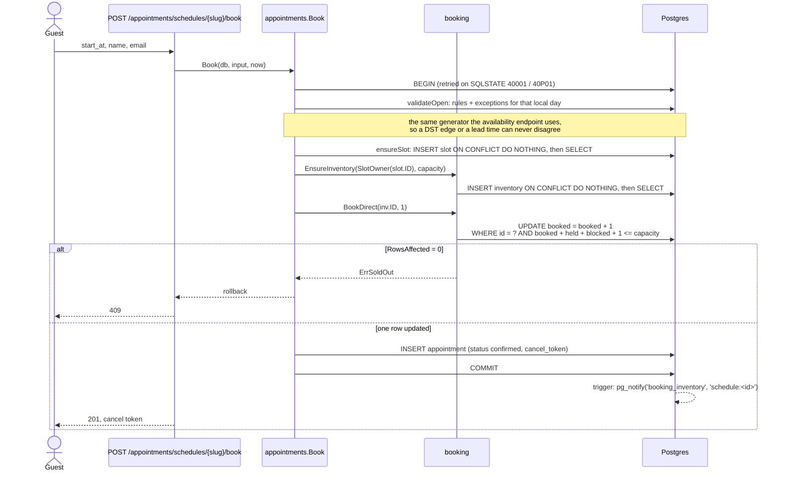
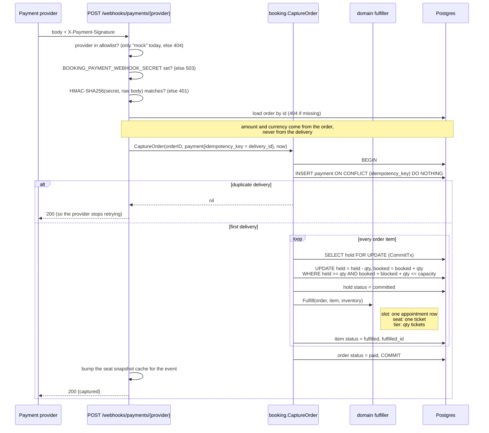
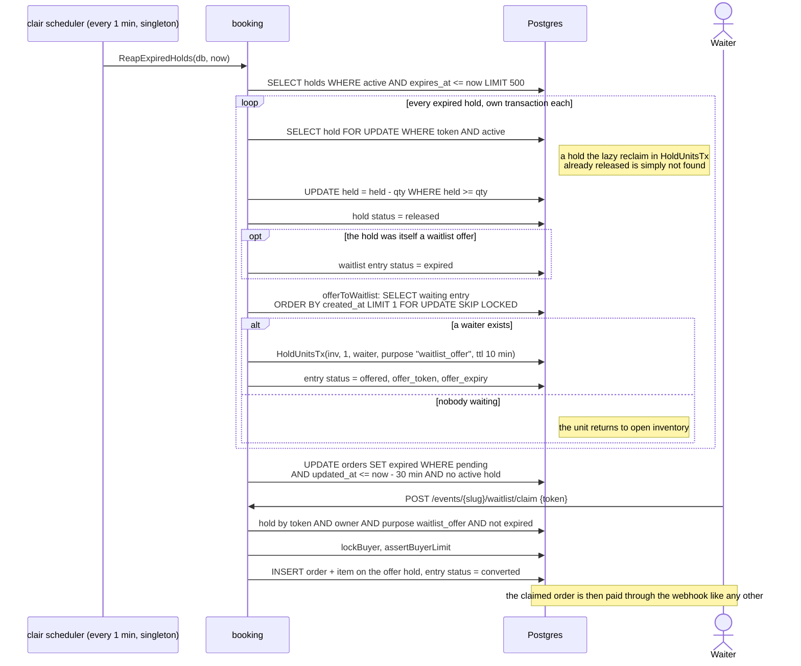
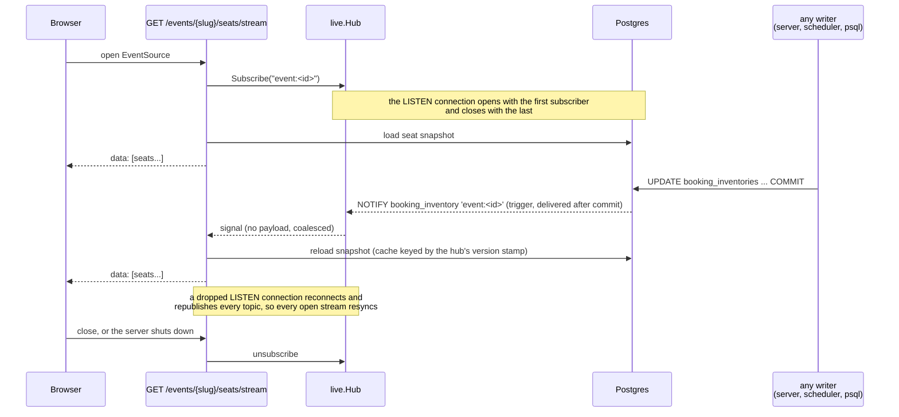

# The booking service

How a seat, a slot or a ticket is reserved, paid for, released and announced. The code is under `internal/booking` (the service), `internal/appointments` and `internal/ticketing` (the two domains on top of it), `internal/server/booking` (HTTP) and `internal/booking/live` (change fan-out). Every diagram below follows the code as of 2026-10-26.

## Layers

One service, two vocabularies. A hospital books time slots, a theater books seats. Both are a counter row that the service guards.



Rules the layers keep:

- `appointments`, `ticketing` and `booking` never import `net/http`.
- One inventory row per bookable unit, owned by exactly one of `slot_id`, `tier_id` or `seat_id`. The invariant is `booked + held + blocked <= capacity`, enforced in the `WHERE` clause of every write, never by a nightly repair.
- The domain registers a fulfiller (`slot`, `tier`, `seat`) in `init()`. Payment capture looks the fulfiller up by the inventory's owner kind, so the service never imports a domain.
- Change notification is a database trigger, not Go code, so the scheduler's writes reach open screens the same way the server's do.

## Free appointment

The hospital, consulate and bureau flows. No hold, no order, no payment: the counter is incremented in one conditional update.



Cancel is the mirror. `POST /appointments/cancel` with the token in the JSON body runs `CancelByToken`: the appointment row is found by token and status, `booking.Cancel` decrements `booked`, the freed unit is offered to the waitlist head, and if the appointment came from a paid order the order and item are marked refunded and a mock refund payment row is written. An unknown or already-cancelled token is a no-op.

## Seat hold

The theater flow. A group of seats is held all or nothing, inside one transaction, with the buyer serialised by an advisory lock.

```mermaid
sequenceDiagram
    actor Buyer
    participant API as POST /events/{slug}/seats/hold
    participant Tix as ticketing.HoldSeatGroup
    participant Svc as booking.HoldUnitsTx
    participant PG as Postgres

    Buyer->>API: seat_ids[]
    API->>Tix: HoldSeatGroup(eventID, seatIDs, buyer, ttl, now, maxPerBuyer)
    Tix->>PG: BEGIN (retried on 40001 / 40P01)
    Tix->>PG: pg_advisory_xact_lock("<event>:<owner>")
    Note over Tix,PG: one buyer, one event, one transaction at a time;<br/>a different buyer is never blocked
    Tix->>PG: assertEventOpen: status = scheduled AND start_at > now
    loop every requested seat (deduplicated)
        Tix->>PG: seat is sellable? tier.event_id = event? same currency?
        Tix->>PG: activeHold(inv, owner, now)?
        Note right of Tix: a seat the buyer already holds is kept, not refused
    end
    Tix->>PG: assertBuyerLimit: fulfilled + live holds + new <= max_per_buyer
    Tix->>PG: INSERT order (domain event, status pending)
    loop every new seat, ascending inventory id
        Tix->>Svc: HoldUnitsTx(inv, 1, owner, orderID, "cart", ttl, now)
        Svc->>PG: WITH reclaimed AS (UPDATE holds SET released<br/>WHERE inv AND active AND expires_at <= now RETURNING qty)<br/>UPDATE inventory SET held = held - SUM(reclaimed)
        Svc->>PG: UPDATE held = held + 1<br/>WHERE booked + held + blocked + 1 <= capacity
        Svc->>PG: INSERT hold ON CONFLICT (inv, owner, active) DO NOTHING
        Tix->>PG: INSERT order item (hold_token, qty 1, reserved)
    end
    alt any seat failed
        Tix->>PG: ROLLBACK (the whole group)
        API-->>Buyer: 409 sold out, or 422 invalid seat
    else
        Tix->>PG: COMMIT
        PG-->>PG: trigger: pg_notify(..., 'event:<id>') once per changed inventory row
        API-->>Buyer: order, holds with expires_at
    end
```

General admission (`POST /events/{slug}/tiers/{tierID}/hold`) is the same shape over one pooled inventory row. A buyer who already holds units of the tier is topped up to the new quantity, and only the difference counts against the cap.

## Payment capture

The only route that turns money into a ticket or a confirmed paid appointment. The provider calls it. There is no session and no CSRF token, so the HMAC over the raw body is the whole of the authentication.



Known gap (roadmap B2): a hold that lapsed between checkout and the webhook makes `CommitTx` return `ErrHoldExpired`, the whole transaction rolls back including the payment row, and the provider gets a 500. There is no void or refund path for a ticket order yet.

## Reaper and waitlist

A hold is temporary only because something releases it. `clair scheduler` is a separate process, because expiry is about time passing, not about a request arriving.



Three places know what "expired" means, and they agree by construction: the reaper's poll, the reclaim CTE at the top of `HoldUnitsTx`, and the `expires_at > now` predicate in `activeHold`, `assertBuyerLimit` and `CommitTx`. Even before the reaper sweeps it, a lapsed hold is unusable.

## Live updates

A screen opens one event stream and subscribes to only what it shows. The change signal comes from the database, so every writer is covered.



Schedules work the same way on `GET /appointments/schedules/{slug}/availability/stream`, with topic `schedule:<id>`. Rule and exception changes announce too, because availability is computed, not stored.

## Open questions about the design

Points worth a decision rather than defects. Each names where the code stands today.

1. **`held` is a maintained counter, not a derived one.** Every hold, commit, release and reclaim adjusts it. Drift cannot oversell, because the statement that writes `booked` re-checks capacity, but drift can undersell until the next reclaim. The alternative is to compute `held` from active holds on every write: simpler to reason about, one more query per hold.
2. **Two roads to an appointment.** The free path (`Book`, `BookDirect`, no order) and the paid path (`HoldSlot`, order, webhook, `slotFulfiller`). `CancelByToken` has to handle both. One path with a zero-price order removes the fork, at the cost of an order row per free booking.
3. **The fulfiller registry is a global map filled in `init()`.** Capture works only if the domain package is linked into the binary. Today `internal/server/booking` imports both domains, so it holds. A future process that captures without the HTTP layer will silently find no fulfiller.
4. **Waitlist offers run inside the release transaction.** `Cancel` and `ReleaseTx` call `offerToWaitlist`, which places a new hold per freed unit. Correct and atomic, but the reaper's per-hold transaction grows with the waitlist.
5. **The per-buyer cap and the buyer lock live in `ticketing` only.** `appointments` has no cap, so one guest can book every slot of a schedule. A3 answered this with rate limiting, not with a domain rule.
6. **`topUpGA` repeats the guarded `held` increment** instead of calling a service primitive, so the capacity predicate is written in two packages.
7. **Inventory ownership is three nullable foreign keys.** `OwnerRef` keeps "exactly one" in one place in Go. The database does not enforce it.
8. **One payment provider, no refund for tickets.** The allowlist holds `mock`. Roadmap items K6 and K7 cover void and refund.
9. **`CancelByToken` reads `time.Now()` and skips the write-retry wrapper**, unlike every other entry point (roadmap K20).
